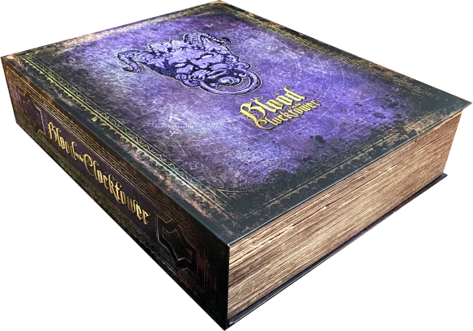
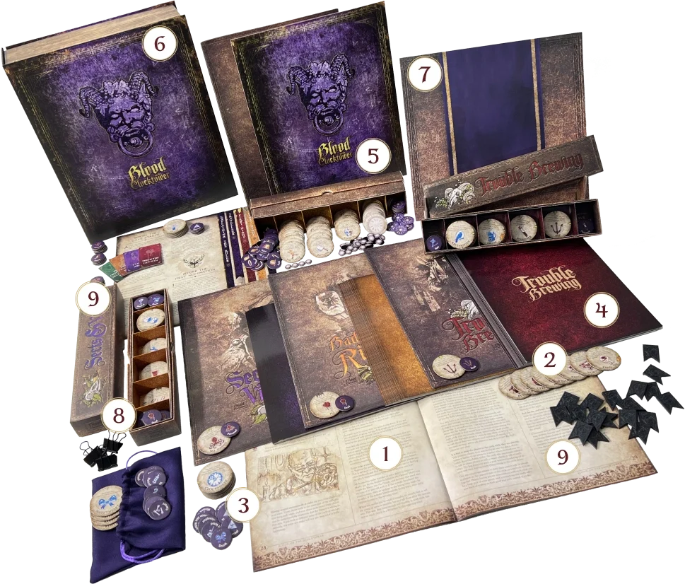
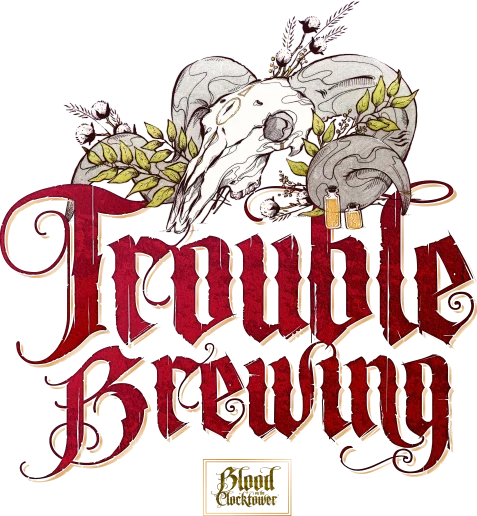
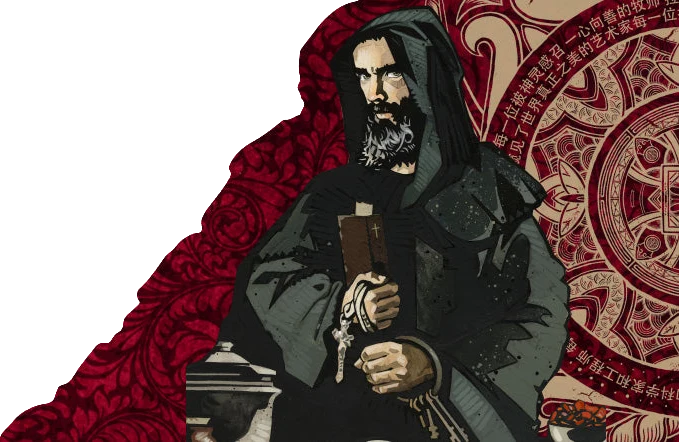
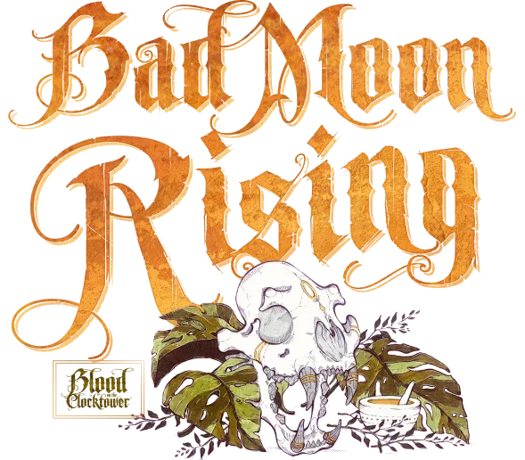
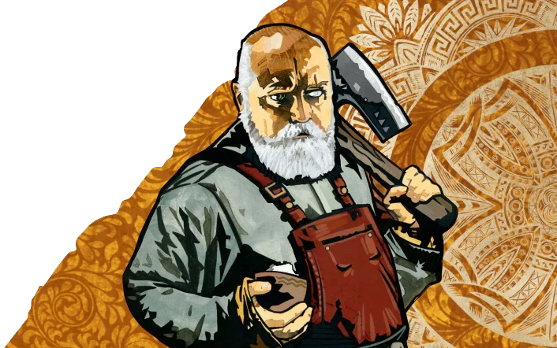
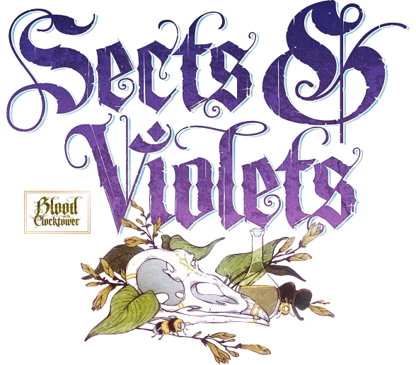
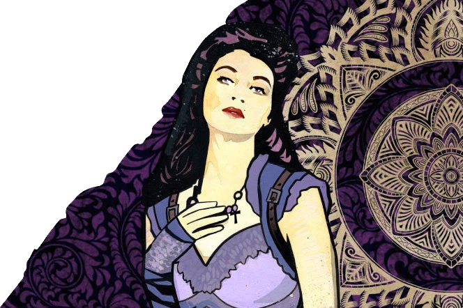
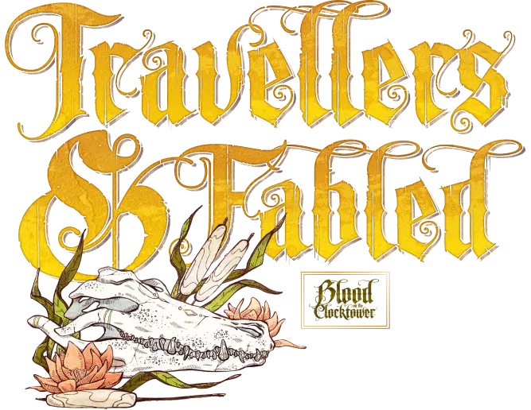

<!-- 1. EN-TÊTE : LE GRIMOIRE ANIMÉ AVEC BOUGIES ET LOTUS -->

<h1>Blood on the Clocktower le jeu</h1>

<!-- 2. SECTION SOMBRE : MATÉRIEL ÉCLATÉ -->

<h3>QU'EST-CE QU'IL Y A DANS LA BOÎTE DE JEU ?</h3>
<ul class="numbered-list">
<li>1 livre de règles principal et 4 almanachs de rôles.</li>
<li>99 rôles uniques : 39 Villageois, 12 Marginaux, 12 Sbires, 9 Démons, 15 Voyageurs, et 12 Légendaires.</li>
<li>120 jetons de rappel pour le Conteur, pour toutes les situations possibles.</li>
<li>60 fiches de rôles - 20 pour chacune des trois premières éditions du jeu.</li>
<li>Plateau de la Place du Village, 20 jetons de vie, et 18+ jetons de vote.</li>
<li>La boîte elle-même forme l'illustre Grimoire ; le guide du Conteur pour chaque partie.</li>
<li>Support pliant pour poser votre Grimoire.</li>
<li>4 boîtes de jetons pour ranger et organiser chaque édition.</li>
<li>Tout le reste pour vous aider à organiser et suivre : 18+ linceuls, 25+ jetons de nuit, 4 jetons d'information, 1 sac en tissu pour la sélection des rôles, 3 fiches de nuit, 1 fiche de mise en place, 1 fiche de Voyageurs, des pinces pour le Grimoire.</li>
</ul>

<!-- 3. SECTION ÉDITIONS : MODULES -->

  <!-- MODULE 1 : TROUBLE BREWING -->
  

    

      
    

    

      <h2>TROUBLE BREWING</h2>
      
DÉBUTANT

      
Trouble Brewing a un peu de tout. Certains rôles reçoivent passivement des informations, d'autres doivent agir pour savoir qui est qui, tandis que d'autres veulent simplement inciter le Démon à les attaquer.

      

        <a href="trouble_brewing.html" class="discover-more-link">DÉCOUVREZ PLUS</a>
      

    

    

      
    

  

  <!-- MODULE 2 : BAD MOON RISING -->
  

    

      
    

    

      <h2>BAD MOON RISING</h2>
      
INTERMÉDIAIRE

      
Bad Moon Rising est un festival de morts. Les Démons tuent plusieurs fois par nuit et les Sbires participent aussi à l'action. Les joueurs du Bien peuvent prendre de grands risques pour obtenir des informations cruciales, mais peuvent accidentellement tuer leurs amis au passage.

      

        <a href="bmr.html" class="discover-more-link">DÉCOUVREZ PLUS</a>
      

    

    

      
    

  

  <!-- MODULE 3 : SECTS & VIOLETS -->
  

    

      
    

    

      <h2>SECTS & VIOLETS</h2>
      
INTERMÉDIAIRE

      
Sects & Violets est la plus folle des 3 éditions incluses dans la boîte de base. Les rôles du Bien obtiennent des informations incroyables chaque nuit. Cependant, l'équipe du Mal est extrêmement variée et menaçante et peut semer une confusion massive dans la partie.

      

        <a href="sv.html" class="discover-more-link">DÉCOUVREZ PLUS</a>
      

    

    

      
    

  

  <!-- MODULE 4 : VOYAGEURS ET LÉGENDAIRES -->
  

    

      
    

    

      <h2>VOYAGEURS ET LÉGENDAIRES</h2>
      
INTERMÉDIAIRE

      
Voyageurs & Légendaires est une collection de rôles sauvages, étranges et puissants qui sont ajoutés selon les besoins aux parties de TROUBLE BREWING, BAD MOON RISING, SECTS & VIOLETS, ou d'autres éditions.

      

        <a href="voyageurs/voyageurs.html" class="discover-more-link">DÉCOUVREZ LES VOYAGEURS</a>
        <a href="legendaire.html" class="discover-more-link">DÉCOUVREZ LES LÉGENDAIRES</a>
      

    

    

      
    

  

<!-- 4. FOOTER OFFICIEL -->

  

    

      
    

    

      <a href="/botc-fr-bambi/">Retour à la page d'accueil</a>
      <a href="#haut-de-page">Revenir en haut de la page</a>
      <a href="bases.html">Découvrir les bases du jeu</a>
    

  

<!-- MODULES DE ZOOM (LIGHTBOX) -->

<a href="#close" class="lightbox-close-btn" title="Fermer">✖</a>

<input type="checkbox" id="toggle-zoom-grimoire" class="lightbox-toggle">
<label for="toggle-zoom-grimoire" class="lightbox-img-wrapper" title="Cliquer pour fermer">

</label>

<a href="#close" class="lightbox-close-btn" title="Fermer">✖</a>

<input type="checkbox" id="toggle-zoom-boite" class="lightbox-toggle">
<label for="toggle-zoom-boite" class="lightbox-img-wrapper" title="Cliquer pour fermer">

</label>

