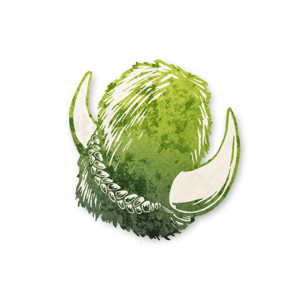

  

<!-- God of Ug -->

  <a href="./godofug.html" style="text-decoration:none;">
    
     
    Dieu Ug
  </a>

« Bénis soient mes enfants,   car ils voient la beauté dans les choses simples. »

##  Informations

<ul style="color:#f5f5f5; font-size:18px; line-height:1.7; margin-left:40px;">
  <li><strong>Type :</strong> <a href="../loric.html" style="color:#7fd1ae; font-weight:bold; text-decoration:none;">Loric</a></li>
  <li><strong>Artiste :</strong> Chloe McDougall</li>
  <li><strong>Révélé :</strong> 19 mars 2026</li>
  <li><strong>Nom original :</strong>
    <a href="https://wiki.bloodontheclocktower.com/God_of_Ug"
       target="_blank"
       rel="noopener noreferrer"
       style="color:#7fd1ae; font-weight:bold; text-decoration:none;">
      God of Ug
    </a>
  </li>
</ul>

## Résumé

« Un chapeau Ug. Quand porter chapeau Ug, on doit parler un son à la fois mais voter deux fois. Si échec, passe chapeau Ug.»

LE DIEU UG oblige les joueurs à ne parler qu'avec des mots d'une seule syllabe.

<ul style="color:#f5f5f5; font-size:20px; line-height:1.7; margin-left:0px;">

  <li>Lorsque le joueur qui porte le chapeau Ug vote, son vote compte pour deux.   Utilisez un vrai chapeau si vous le pouvez.</li>

  <li>Tout mot qui possède une seule syllabe compte.   Les entourloupes avec des mots composés ne comptent pas.   Prononcer un seul mot de plusieurs syllabes suffit pour perdre le chapeau Ug.</li>

  <li>Le Conteur choisit qui porte le chapeau Ug en premier. Si un joueur prononce un mot de plusieurs syllabes, met trop de temps à parler, ne s'amuse pas du tout ou porte le chapeau Ug depuis trop longtemps, le Conteur choisit un nouveau joueur pour porter le chapeau Ug.</li>

  <li>N'importe quel joueur peut porter le chapeau Ug   Un joueur peut refuser de le porter s'il le souhaite.   Un même joueur peut recevoir le chapeau Ug plusieurs fois.</li>

  <li>Si le Conteur n'est pas présent, on se fie à la bonne foi de chacun.   N'importe quel joueur qui surprend le porteur du chapeau Ug à prononcer un mot de plusieurs syllabes peut le signaler, et le chapeau Ug lui est retiré.</li>

  <li>Chaque jour, le Conteur peut désigner un nouveau joueur pour commencer avec le chapeau Ug, ou laisser le joueur du jour précédent.</li>

</ul>

<h2 style="color:#7fd1ae;">Comment Conter</h2>

Instructions au Conteur

Au début de la partie, donnez le chapeau Ug au joueur de votre choix.    Si vous-même ou un joueur surprenez ce joueur en train de prononcer un mot de plusieurs syllabes, donnez le chapeau Ug à un autre joueur.  

Lorsque le joueur qui porte le chapeau Ug vote, son vote compte double.

Si le port du chapeau Ug devient pesant ou ne fait plus rire, limitez-le uniquement à la phase des nominations.

##  Exemples

Amy porte le <strong>chapeau Ug</strong>. Lorsqu’elle est nommée, elle dit :  
« Pas moi. Je crois Ben a trop causé au gars pas bon. Lui pas bon. » 
Amy garde le chapeau Ug.

Lewis a le chapeau Ug. Lors une conversation privée avec Julian et Alex, Lewis dit :  
«  Je crois vous deux très bons. Je suis le piaf qui voit un gars quand je meurs. Je veux que le Démon me tue pour qu'on ait ce nom plus tard. »  
Le Conteur donne le chapeau Ug à Abdallah, car « Démon » est un mot de plusieurs syllabes.

• <a href="/botc-fr-bambi/" style="color:#f5f5f5; font-weight:bold; text-decoration:none;">Retour à l’accueil</a> 
• <a href="../loric.html" style="color:#7fd1ae; font-weight:bold; text-decoration:none;">Retour aux rôles Loric</a>

